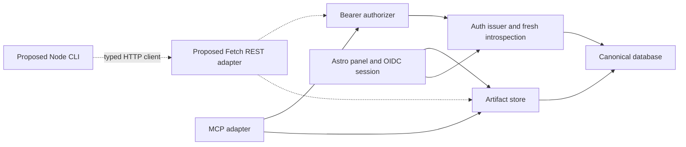

# REST and CLI architectural grounding

## Overview

Artifacts already has the persistence and authorization model needed by an independent HTTP API. MCP and the Astro panel call `createArtifactStore`, which owns retained snapshots, immutable revisions, receipts, publication, and export. A REST adapter can expose those operations directly, and a CLI can consume that API without a database connection or MCP session. This is the extension supported by the source findings, not an implemented capability. See `packages/artifacts/src/index.ts:23` and `docs/decisions/artifacts.md`.

Keep existing ownership. The domain decision deliberately places every mutation in one transactional store. The identity decision kept authentication local because MCP bearer credentials and panel cookies had different contracts. REST adds a second bearer consumer, which justifies sharing the bearer authorizer. It does not justify merging panel OIDC into that policy or routing existing MCP operations through HTTP. See `docs/decisions/identity.md:9` and `.audit/design/local/rationale.md:19`.

## Key concepts

- `Snapshot` contains complete metadata, content, and retained attachments. An update replaces this complete value. `ArtifactRead` contains owner identity, current head, optional publication, and one immutable revision. See `packages/artifacts/src/contracts.ts`.
- `Actor` carries a verified canonical user, central session, OAuth client, and scopes. Transports derive it from authenticated credentials. User-supplied actor fields are never authority. See `packages/artifacts/src/contracts.ts:55`.
- A command receipt belongs to an owner and request ID across clients, operations, and transports. Its fingerprint includes the parsed command input. The receipt and mutation commit together. See `packages/artifacts/src/index.ts:64`.
- Publication is a versioned pointer to a retained revision. It is independent of the draft head and does not make the protected viewer public. See `packages/artifacts/src/index.ts:117` and `apps/dashboard/src/publish.ts:25`.
- The OAuth resource audience is currently the full configured `MCP_URL`, including its path. A different REST URL does not automatically establish another registered resource. See `apps/mcp/src/http.ts:10` and `apps/auth/src/bootstrap.ts:19`.

## How it works

The diagram shows the authoring dependencies. Solid arrows are existing dependencies, and dashed arrows are proposed additions.

### Authentication and admission

The existing public OAuth flow discovers the issuer, registers a public native client, and authorizes in the account browser with PKCE S256. The client exchanges its callback code with the original verifier and resource. Dynamic registration remains enabled. A standalone CLI can reuse this flow without receiving a confidential client secret. This conclusion follows `apps/auth/src/auth-core.ts:25` and the real HTTP fixture in `tests/helpers.ts:55`.

`createMcpAuthorizer` first verifies JWT signature, issuer, resource audience, expiry, and required identity claims. It requires a nonempty central session ID and agreement between `client_id` and `azp`. Every protected request then obtains fresh introspection using the resource server's confidential Basic credentials. The authorizer rejects redirects, requires HTTP 200, and reconciles introspected identity, audience, expiry, and scopes with the JWT. See `apps/mcp/src/identity.ts:18` and `:35`.

The store independently checks the operation scope and the live central session's relationship to the user. This protects reads and mutation receipt replay. A validly signed token alone is insufficient, and an MCP protocol session grants no identity. See `packages/artifacts/src/index.ts:29`, `:40`, and `:64`, plus `apps/mcp/src/http.ts:26`.

The panel follows a separate confidential OIDC flow. It consumes durable login transactions once, validates PKCE, state, nonce, issuer, audience, and signature, then creates an opaque panel session tied to the verified central session. Each panel request checks the live relationship again. Global revocation deletes central sessions, which cascades panel-session deletion. Panel logout deletes only its panel session. See `apps/dashboard/src/identity.ts:29`, `:40`, `:51`, and `:59`, plus `apps/auth/src/revocation.ts:5`.

### Commands, conflicts, and retries

Creation and update parse strict schemas and hash canonical complete snapshots. The command transaction checks authorization before looking up a receipt. A matching owner/request receipt returns its original complete result. Reusing that ID with different arguments produces `request_conflict`. See `packages/artifacts/src/index.ts:64`, `:80`, and `:102`.

An update compares `expectedRevisionId`, inserts a new immutable revision, and conditionally moves the head. A losing comparison rolls back the revision and receipt. Publication similarly compares `expectedPublicationVersion` before a same-revision no-op. SQLite busy retries preserve the caller's original expectations. They do not rebase a losing command. These rules remain in the store for every adapter, as traced in `ground-domain.md`.

For convenience edits, `prepareArtifactEdit` reads a full current head and creates a frozen complete update while preserving omitted fields. The CLI should persist that command before submission and retry the exact value after an uncertain network result. This is a design recommendation derived from the existing workflow contract in `packages/artifacts/src/workflow.ts:121`. An explicit conflict requires a deliberate new operation.

Publication grants bind the artifact, owner, session, callback, browser state, and short expiry. Consumption deletes the grant atomically. Published reads recheck viewer validity, the live owner/session relationship, and the current publication. Export uses the ordinary authorized retained-revision read and produces deterministic ZIP bytes. REST can return those bytes without inventing another archive format. See `packages/artifacts/src/index.ts` and `apps/dashboard/src/pages/artifacts/[artifactId]/export.ts`.

### Composition decisions still open

A reusable Fetch handler can remain independent of MCP while sharing its deployed Worker. A separate REST Worker adds configuration, build, release, deployment, and smoke-test responsibilities. The current service registries enumerate `auth`, `mcp`, `panel`, and `view`. See `scripts/build-workers.ts:11`, `scripts/deploy-worker.ts:7`, and `scripts/release-production.ts:15`.

If REST shares the existing resource audience, it can reuse the bearer policy and registered introspection client. A distinct audience requires provider registration, client grants and links, an introspection resource link, and explicit validation of that audience. The architectural comparison must select this contract. Neither grounding report found a need for a database migration solely to add REST or the CLI.

The CLI still needs trusted endpoint configuration, native loopback callbacks, browser launch, state validation, private token persistence, atomic refresh rotation, and cross-process refresh coordination. Existing `openid-client` 6.8.8 is a concrete library candidate. Node callback and credential-storage code must stay out of Worker bundles. See `apps/dashboard/package.json:23` and `scripts/build-workers.ts:53`.

## Where things live

- `packages/artifacts/src/contracts.ts` and `workflow.ts` provide database-free contracts and prepared edits for a network client. The main package entry owns SQL and ZIP generation.
- `apps/mcp/src/identity.ts` owns the bearer policy to extract. `apps/mcp/src/http.ts` owns MCP discovery, admission, tool dispatch, and result projection.
- `apps/auth/src/auth-core.ts`, `bootstrap.ts`, and `http-core.ts` own OAuth issuance, confidential client setup, account actions, and the narrow native-registration compatibility repair.
- `apps/dashboard/src/identity.ts`, `middleware.ts`, and `publication.ts` own panel admission and actor construction.
- `packages/db/src/schema.ts` and `packages/db/migrations/0001_sleepy_bastion.sql` own persistence constraints. `packages/config/src/index.ts` owns service URL and scope configuration.

## Gotchas and evidence limits

- Omitted `response`, explicit `"full"`, and `"compact"` can produce different receipt fingerprints. Preserve omissions and array order through preparation, transport, and replay. The store returns full results before adapter projection. See `tests/workflow.test.ts:182` and `packages/artifacts/src/serialization.ts`.
- A receipt reports the original committed result. It does not prove that its head or publication is still current. The panel rereads publication separately for this reason. See `apps/dashboard/src/publish.ts:25`.
- Central revocation can leave refresh tokens capable of producing a JWT with `sid: null`. Rejecting missing session identity and checking fresh introspection remain necessary. Local logout and JWT revocation cannot promise account-wide revocation. See `docs/decisions/identity.md:23` and `tests/oauth.test.ts:106`.
- MCP currently requires `artifacts:read` at transport admission even for write tools. REST admission scopes require an explicit decision while the store retains operation-specific enforcement. See `apps/mcp/src/http.ts:19`.
- The decoded snapshot limit differs from HTTP JSON size because base64 and escaping add bytes. A REST request cap must account for wire overhead. The current MCP raw-body cap is 8 MiB, as recorded in `ground-domain.md`.
- Native callback matching permits variable ports, not arbitrary hosts or paths. Register `application_type: native` explicitly. The existing repair only covers a narrow omitted-type case. See `apps/auth/src/http-core.ts:26` and `ground-identity.md`.

This synthesis relies on the two bounded source/history explorations in `ground-domain.md` and `ground-identity.md`. They did not run tests. The task frame records a baseline of 59 passing tests, which this synthesis did not rerun. `.audit/artifact-e2e/runtime.md:5` records historical deployed Codex and Claude acceptance, not current REST or CLI behavior.

New acceptance must exercise actual CLI subprocesses, authenticated direct HTTP, exact receipt replay, competing writers, scope and revocation denial before replay, and interoperability with MCP and the built panel. Fixture OAuth alone does not prove interactive CLI consent. Run browser proof and Worker builds sequentially when they share dashboard output. See `.audit/rest-cli/frame.md`, `.agents/skills/verify-artifacts/features/identity.md:23`, and `docs/workflow/decisions.tsv`.

Boundary Discipline shaped the recommendation to share identical bearer policy while retaining domain and panel ownership. Prove It Works shaped the explicit separation between source findings, historical observations, and the still-required REST and CLI runtime evidence. Their leaf skills were read for this synthesis.
